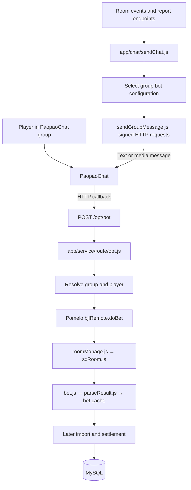
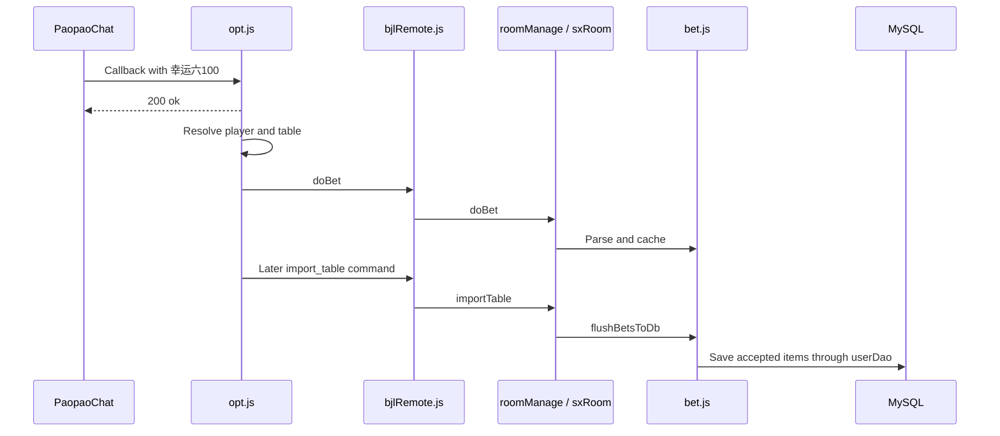

# PaopaoChat integration

This document explains how this repository connects to PaopaoChat, based on the current source code. It describes the implementation, not an independently verified external API specification. Credentials below are placeholders; no live messages were sent while preparing this document.

## 1. Two directions of communication

The system receives chat events through an HTTP callback and sends messages through PaopaoChat's HTTP API. Pomelo RPC connects the HTTP gateway to the game process internally. The project's client WebSocket service is a separate channel used for control/game UI notifications.



## 2. Relevant files

| File | Responsibility |
| --- | --- |
| `app.js` | Start Pomelo; register Redis, locks, and MySQL; load HTTP on the gate process |
| `app/service/httpserver.js` | Mount `/opt`; exempt `/opt/bot` from normal login-token middleware |
| `app/service/route/opt.js` | Receive callbacks, map chat identities, dispatch bets, handle remarks and report sending |
| `app/chat/sendChat.js` | Select a group bot; send text; prepare/upload images and videos |
| `app/chat/sendGroupMessage.js` | Build outgoing requests, calculate signatures, call PaopaoChat APIs |
| `app/dao/systemDao.js` | Map chat groups to table configuration |
| `app/dao/userDao.js` | Map chat senders to players and persist bets/results |
| `app/dao/Cache.js` | Redis-backed cache operations |
| `app/servers/bjl/remote/bjlRemote.js` | Receive internal game RPC calls |
| `app/domain/roomManage.js` | Locate the target room |
| `app/domain/sx/sxRoom.js` | Coordinate room operations and outgoing game images |
| `app/domain/sx/bet.js` | Cache/import bets |
| `app/domain/sx/result.js` | Calculate settlement |
| `app/domain/sx/virtualBet.js` | Send configured virtual-player commands using separate account configuration |

## 3. Configuration and identity mapping

### Default configuration

`config/config.json` contains the `paopaochat` object used by the callback handler and default outgoing API client:

```json
{
  "paopaochat": {
    "appId": "<application-id>",
    "token": "<incoming-callback-token>",
    "secret": "<outgoing-signing-secret>",
    "baseUrl": "https://bot.paopaochat.com"
  }
}
```

| Setting | Used for |
| --- | --- |
| `appId` | Incoming callback app-ID comparison and outgoing `x-appid` header |
| `token` | Comparison with incoming `x-token` |
| `secret` | HMAC signing of outgoing requests |
| `baseUrl` | Base address for outgoing API requests |

The incoming callback token and outgoing signing secret have different roles. The normal system login header `token` is a third, separate authentication mechanism.

### Bot account selected per group

For ordinary outgoing text/media, `sendChat.js` resolves:

```text
Paopao chatId
  → Redis key pull_table_nickname_<chatId>
  → on cache miss: group_chat_setup row by chat_id
  → row.pull_table_nickname
  → config/mac_token.json entry with that name
  → appId / secret / baseUrl for outgoing request
```

An explicit configuration passed by a caller takes priority. If no usable per-group configuration is selected, the lower-level request function falls back to `config/config.json.paopaochat`.

`config/token.json` is loaded by `virtualBet.js` for virtual-player sending. It is separate from the ordinary group's `mac_token.json` selection.

### Important identifiers

| Field | Meaning |
| --- | --- |
| `chatId` / `chat_id` | PaopaoChat group identifier |
| `group_nickname` | Internal configured group/table name |
| `chat_group_nickname` | Chat group name used during fallback lookup |
| `group_chat_setup.Id` / `roomId` | Internal game-room identifier |
| `pull_table_nickname` | Key selecting an outgoing bot configuration |
| `senderId` | PaopaoChat sender identifier |
| `user.chat_user_id` | Stored association between chat sender and player |
| `nickname` | Callback nickname used as a fallback internal username |
| `clientId` | Callback duplicate-detection key |
| `msgId` | Chat message identifier used in downstream ordering and bet processing |

Keep large chat IDs as strings. The callback code explicitly tries to quote a numeric `chatId` inside the raw JSON string before parsing to avoid JavaScript integer precision loss.

## 4. Incoming callback: PaopaoChat to the system

The receiver implemented here is:

```text
POST <public-system-base-url>/opt/bot
```

`app.js` loads `httpserver.js` in the gate role. That file mounts `/opt`, and `opt.js` defines `router.post('/bot', ...)`. The public domain/proxy and registration of this callback on PaopaoChat are deployment settings, not established by this route definition. The backend HTTP port comes from `config.http.port`.

### Request example

```http
POST /opt/bot
Content-Type: application/json
x-token: <incoming-callback-token>
x-timestamp: <current-Unix-time-in-milliseconds>
```

```json
{
  "chatType": 2,
  "groupRole": 3,
  "nickname": "demo-player",
  "appId": "<application-id>",
  "msg": "{\"chatId\":\"<group-id>\",\"clientId\":\"<unique-event-id>\",\"content\":\"幸运六100\",\"msgId\":12345,\"senderId\":\"<sender-id>\"}"
}
```

The current implementation expects `msg` to be a JSON **string**, then parses it. It accepts the outer payload directly or under `req.body.data`.

### Processing steps

1. Parse `data.msg` and preserve the large chat ID where possible.
2. Compare `x-token` to `Config.paopaochat.token`.
3. Check the timestamp difference against a 60,000 ms window.
4. Require `chatType === 2` (group chat) and a matching configured app ID.
5. Check Redis key `clientId:<clientId>` for a duplicate.
6. Return HTTP `200` with text `ok` before continuing business processing.
7. Cache the client ID with a 70-second expiry.
8. Handle `/remark`, administrator filtering, announcements, and input normalization.
9. Resolve the configured table and player.
10. Parse the bet and call `pomelo.app.rpc.bjl.bjlRemote.doBet(...)`.

Rejected tokens, stale timestamps, wrong application IDs, and duplicates can also receive `200 ok`. An HTTP acknowledgement alone does not prove that the bet was accepted.

### Group lookup

```text
systemDao.getGroupPullDataSetupByChatId({ chat_id })
  → SELECT from group_chat_setup by chat_id
  → if missing: getGroupInfo([chatId]) via POST /chat/info
  → obtain the chat group name
  → getGroupPullDataByChatGroupNickname(...)
  → setGroupChatId(...) to persist the association
```

Once found, the callback assigns the internal `group_nickname` and `roomId`. If no table can be resolved, it does not dispatch the bet into a room.

### Player lookup

The route first calls `getPlayerByChatUserId(senderId)`. If not found, it falls back to `getUserByName(nickname)`. It checks an existing chat-user association for mismatch and can call `updatePlayerChatUserId` to bind the sender. Missing or mismatched players generate deferred import notices rather than a valid bet.

### Message filtering

- Root-level `groupRole` is used for administrator detection.
- The current administrator comparison is role `2`; role constants also define owner `1` and member `3`.
- Administrators are prevented from betting and can generate a deferred notice.
- Long announcements and ordinary non-betting text are filtered out.
- Spaces and line breaks are normalized; several characters resembling `x` are converted to `x`.
- Bet errors may be deferred until import.

## 5. A chat bet is cached before it is imported



Import is a separate command (`POST /opt/import_table`). It applies stop-message boundaries, replacements, limits, balance checks, and all-in calculations. Settlement is another stage, typically initiated through `POST /opt/lottery_draw`. See `PROJECT_ENDPOINT_FLOW.md` for those request examples.

## 6. Outgoing requests: system to PaopaoChat

### Text

```js
// Illustrative call; requires a running configured application.
await sendChat.sendTextMessage('开始下注', '<group-id>');
```

Call chain:

```text
Room logic / report route
  → sendChat.sendTextMessage(message, groupId, optionalConfig)
  → choose bot account
  → sendGroupMessage(groupId, message, options, config)
  → sendRequest('POST', '/chat/bot/api/message/send', body, false, config)
  → Axios HTTP request to config.baseUrl + path
```

Text request body:

```json
{
  "chatType": 2,
  "chatId": "<group-id>",
  "msgType": 1,
  "body": "开始下注"
}
```

### Outgoing authentication

`sendGroupMessage.js` generates a timestamp and random nonce. For a JSON POST it hashes the exact serialized body with SHA-256, then builds:

```text
appId + newline
timestamp + newline
nonce + newline
UPPERCASE_HTTP_METHOD + newline
path
[newline + bodySha256, when present]
```

The signature is the hexadecimal HMAC-SHA256 of that string using the selected `secret`.

Headers:

```http
x-appid: <selected-app-id>
x-timestamp: <milliseconds>
x-nonce: <random-value>
x-signature: <calculated-HMAC>
Content-Type: application/json; charset=utf-8
```

In this implementation, GET and multipart upload signing do not include the JSON body hash. Axios uses a 30-second timeout and connection reuse. Responses with application `code` 200 or 0 are treated as success; other codes and HTTP failures raise errors in `sendRequest`.

### Images and videos

`sendChat.sendImageMessage(filePath, fileName, groupId, options)` performs the media workflow:

1. Select the group bot configuration.
2. Read the local file and calculate a SHA-256 hash.
3. Attempt a hash-existence check to reuse uploaded media.
4. If needed, prepare image dimensions/compression or video metadata and upload multipart data with the file and SHA-256.
5. Build a message referring to the uploaded media identifiers.
6. Send the final chat message through `/chat/bot/api/message/send`.

| Message type | Meaning | Relevant fields |
| --- | --- | --- |
| 1 | Text | `body` |
| 2 | Image | `name`, `thName`, `width`, `height`, `size` |
| 13 | Video | `name`, `coverName`, `width`, `height`, `duration`, `size` |

The upload helper inside `sendImageMessage` retries up to three attempts. Successful upload and successful message delivery are separate steps.

## 7. API paths used by the code

These paths are relative to the selected outgoing `baseUrl`.

| Method and path | Purpose |
| --- | --- |
| `POST /chat/bot/api/message/send` | Send text, image, or video to a group |
| `POST /storage/bot/api/msg/file/upload` | Upload media |
| `GET /storage/bot/api/msg/file/hash/check` | Check whether a media hash already exists |
| `POST /chat/info` | Resolve group information |
| `POST /chat/bot/api/message/refresh` | Edit a message through the helper function |
| `POST /chat/group2/mgr/member/remark/set/op` | Set a member's administrator remark |

`getGroupInfo`, remark handling, and message refresh use the default request configuration in the inspected code; they do not automatically run the per-group bot-selection logic in `sendChat.js`.

## 8. Reports and administrator remarks

Outgoing report callers include `/opt/send_bet_report_image`, `/opt/send_score_report_image`, and `/opt/send_road_image`. They call `sendChat.sendImageMessage` with the group's `chat_id`. Room logic in `sxRoom.js` also sends configured game images. Bet-report handling can send configured follow-up text through `sendTextMessage`.

When content contains `/remark`, the callback invokes `setMgrRemark`. That function requires a group callback and administrator role, exactly one mentioned user, and nonempty remark text. It calls the remark API with:

```json
{
  "chatId": "<group-id>",
  "uid": "<mentioned-user-id>",
  "mgrRemark": "demo-player"
}
```

It then sends a success/error text message back to the group.

## 9. Troubleshooting the current implementation

| Symptom | Check |
| --- | --- |
| No incoming callbacks | Public routing to the gate HTTP service and configured callback URL |
| Callback returns ok but no bet appears | Token/app ID, timestamp, duplicate client ID, role filtering, group/player binding, and downstream logs |
| Group not found | `group_chat_setup.chat_id`, fallback chat group name, and `/chat/info` access |
| Player not found or mismatched | Callback nickname, sender ID, and `user.chat_user_id` |
| Bet received but not stored | Room exists, cache/import stage, stop boundary, limits, and balance |
| Message sent by unexpected bot | `pull_table_nickname`, its Redis cache, matching `mac_token.json` entry, and default fallback |
| Signature failure | Selected app ID/secret, request method/path, exact serialized body, and clock |
| Upload succeeds but image is absent | Final message-send result and uploaded media identifiers |

Observed implementation details that affect debugging:

- `sendImageMessage` currently passes an undeclared `config` variable to its hash-check call instead of `options.config`. The surrounding catch suppresses that failure, so it falls back to the upload path rather than successfully using the hash shortcut. This document does not change that code.
- `sendTextMessage` logs the API response but does not return it, and catches/logs errors. Callers cannot use its returned value as a delivery confirmation.
- Callback duplicate detection is a separate Redis get/set/expire sequence, not an atomic deduplication operation.
- The timestamp expression checks the time difference but does not explicitly reject nonnumeric values; an invalid value becomes `NaN`. The earlier processing list describes the intended freshness check, not strict input validation.
- Comments mention both administrators and owners, but the current betting block compares only against administrator role `2`. The remark function also requires role `2`, with a strict type comparison.
- Configuration files are loaded with `require`; edits generally require restarting the relevant processes. The group bot-selection cache can also retain an earlier mapping.

## 10. Reading order

```text
app.js
  → app/service/httpserver.js
  → app/service/route/opt.js: /bot
  → app/dao/systemDao.js and app/dao/userDao.js: identity mapping
  → bjlRemote.js → roomManage.js → sxRoom.js → bet.js

For outgoing messages:
  opt.js or sxRoom.js
  → app/chat/sendChat.js
  → app/chat/sendGroupMessage.js
  → PaopaoChat HTTP API
```

Related documents: `PROJECT_ENDPOINT_FLOW.md` for project routing and `RULE_AND_CAL_METHOD.md` for bet syntax and payout calculations.
