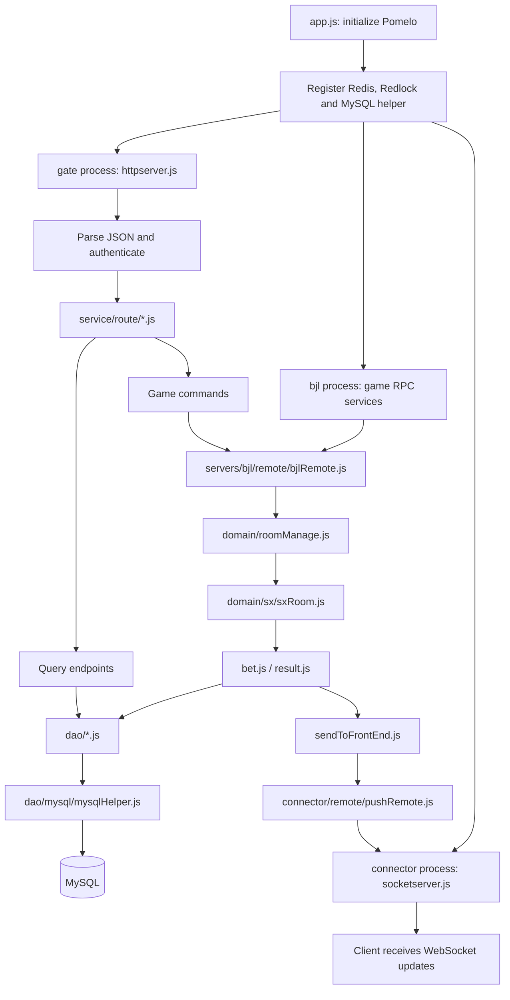
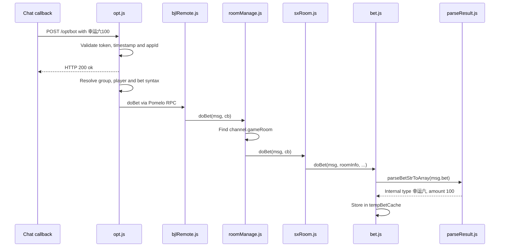
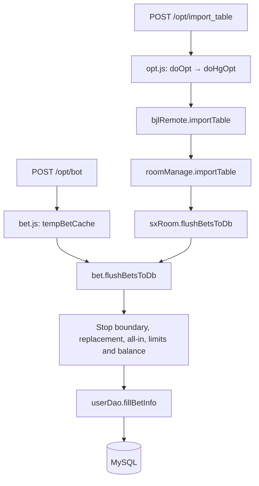
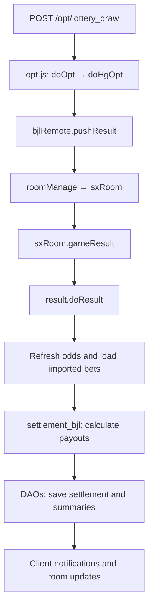
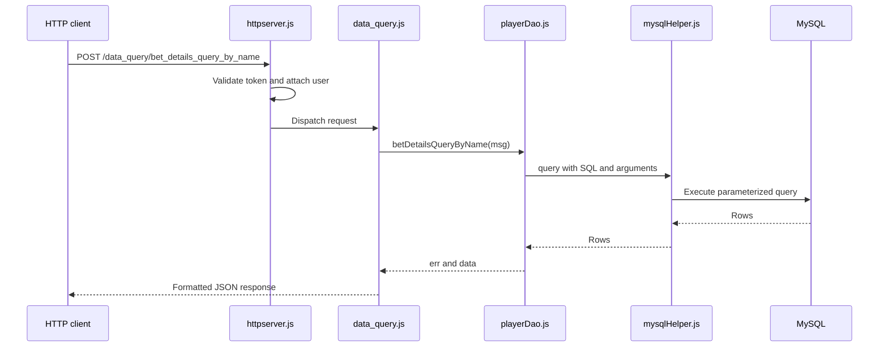

# Project endpoint flow and file connections

The project uses Express for HTTP endpoints, Pomelo RPC for game commands, and DAOs for database access. `app.js` starts the services; incoming requests enter through the registered endpoints.

## 1. Architecture



## 2. Startup: app.js

`app.js` creates the Pomelo application, loads configuration, registers shared services, and calls `app.start()`.

| Startup operation | Purpose |
| --- | --- |
| `pomelo.createApp()` | Create the application |
| `app.loadConfig(...)` | Load MySQL and application settings |
| `app.set("redis", ...)`, `app.set("redis2", ...)` | Register Redis clients |
| `app.set("redlock", ...)` | Register distributed locking |
| `app.set("sqlHelper", ...)` | Register the MySQL connection helper |
| Load `httpserver.js` in the gate role | Start Express HTTP endpoints |
| Load `socketserver.js` in the connector role | Start the WebSocket server |
| `app.start()` | Start Pomelo services |

These are process roles, not a sequence in which every request visits every server. Pomelo loads its handler and remote modules through its server conventions; Express routers are explicitly imported and mounted.

## 3. How routes become endpoints

```js
// app/service/httpserver.js
let opt = require("./route/opt");
app.use("/opt", opt);

// app/service/route/opt.js
router.post("/import_table", async function(req, res) {
    // Handle the command.
});
```

The prefix `/opt` plus the router path `/import_table` creates **POST /opt/import_table**.

| HTTP prefix | Router file |
| --- | --- |
| `/opt` | `app/service/route/opt.js` |
| `/user` | `app/service/route/user.js` |
| `/system` | `app/service/route/system.js` |
| `/player` | `app/service/route/player.js` |
| `/data_query` | `app/service/route/data_query.js` |
| `/ht/...` | Corresponding modules under `app/service/route/ht/` |

HTTP listens on `config.http.port`. WebSocket listens on `config.http.wsport`.

Before ordinary routes run, Express applies CORS, body parsing, and `tokenMiddleware`. Protected endpoints check the IP blacklist and the `token` header, then attach the authenticated user to the request. Login/registration routes and `/opt/bot` are exempt from that token middleware. The bot endpoint performs its own callback validation.

## 4. Example: receiving 幸运六100

The chat callback enters through **POST /opt/bot**.



File chain:

```text
app.js
  → app/service/httpserver.js
  → app/service/route/opt.js                   POST /bot
  → app/servers/bjl/remote/bjlRemote.js        doBet()
  → app/domain/roomManage.js                  locate the room
  → app/domain/sx/sxRoom.js                   doBet()
  → app/domain/sx/bet.js                      process/cache
  → app/domain/sx/parseResult.js              parse the input
```

`opt.js` also parses the input before dispatching the RPC. `roomManage.js` looks up the channel named from `msg.rType + '_game_' + msg.roomId` and accesses `channel.gameRoom`. A missing room produces an error instead of accepting the bet into that room.

The HTTP `ok` acknowledges the callback; it does **not** confirm database import or successful settlement. The route responds before completing downstream processing.

### Illustrative callback request

```http
POST /opt/bot
Content-Type: application/json
x-token: <configured-callback-token>
x-timestamp: <current-Unix-time-in-milliseconds>
```

```json
{
  "chatType": 2,
  "groupRole": 3,
  "nickname": "demo-player",
  "appId": "<configured-app-id>",
  "msg": "{\"chatId\":\"<bound-group-id>\",\"clientId\":\"<unique-message-id>\",\"content\":\"幸运六100\",\"msgId\":12345,\"senderId\":\"<player-chat-id>\"}"
}
```

The current endpoint expects `msg` as a **JSON string**. It checks the configured callback token, timestamp freshness, group chat type, app ID, and duplicate client ID. The group and player must resolve to existing configured records.

The parser returns:

```js
[{ type: "幸运六", amount: 100 }]
```

That internal name maps to database field `l`. Following the lucky-six update, settlement pays this field on both two-card and three-card banker-six outcomes. See `RULE_AND_CAL_METHOD.md` for the detailed calculation rules.

## 5. Import: cached bets become database records



Example for an existing configured group:

```http
POST /opt/import_table
Content-Type: application/json
token: <login-token>
```

```json
{
  "group_nickname": "demo-table"
}
```

1. `opt.js` assigns the import event and calls `doOpt`.
2. `doOpt` loads the group's table configuration and constructs the room message.
3. `doHgOpt` selects `bjlRemote.importTable` through its event switch.
4. `roomManage.importTable` finds the room and calls `room.flushBetsToDb`.
5. `sxRoom.js` coordinates the flush and table lock.
6. `bet.js` processes cached items and calls `userDao.fillBetInfo` for accepted items.

Import is item-based: one failed item does not necessarily mean every item failed. The cache can retain items for retry.

## 6. Settlement: calculate payouts



Example:

```http
POST /opt/lottery_draw
Content-Type: application/json
token: <login-token>
```

```json
{
  "group_nickname": "demo-table",
  "shoe": 1,
  "round": 1,
  "result": 65
}
```

The route maps `result` to `msg.result_code`, `shoe` to `msg.cc`, and `round` to `msg.jc`.

`65 = 1 | 64`: banker win plus three-card banker six. For an imported `幸运六100` and configured three-card odds of `2000`:

```text
Profit = 100 × 2000 / 100 = 2,000
Return = 100 stake + 2,000 profit = 2,100
```

These examples describe request shapes. They were not executed against a live server; actual requests require valid authentication, configured groups, and the appropriate room/round state.

## 7. Query endpoint: direct DAO path

**POST /data_query/bet_details_query_by_name** reads records without going through a game-room RPC.



Example body, with the normal `token` header:

```json
{
  "group_nickname": "demo-table",
  "name": "demo-player",
  "startTime": "2026-10-09",
  "endTime": "2026-10-09"
}
```

`playerDao.betDetailsQueryByName` queries `gameshist_record` and `gameshist` with `UNION ALL`, joins `user` by user ID, and filters by group, username, and statistics date. The route translates database fields into response fields such as `nickname`, `shoe`, `betMoney`, `profit`, and `result_status`.

## 8. How files communicate

| Mechanism | Example | Meaning |
| --- | --- | --- |
| `require(...)` | `require('./parseResult')` | Load a module in the current process |
| Direct function call | `bet.doBet(...)` | Call business logic in the current process |
| `app.set` / `app.get` | `pomelo.app.get('sqlHelper')` | Register/retrieve a shared service within a process |
| Pomelo RPC | `pomelo.app.rpc.bjl.bjlRemote.doBet(...)` | Dispatch a call to a game server process |
| Room lookup | `channel.gameRoom` | Locate the stateful room instance |
| DAO call | `userDao.fillBetInfo(...)` | Execute persistence logic |
| HTTP response | `res.send(...)` | Reply to the original HTTP request |
| WebSocket push | `sendNoticeToGameClient(...)` | Notify connected clients independently of an HTTP response |

The notification chain is:

```text
Game logic
  → app/domain/sx/sendToFrontEnd.js
  → Pomelo connector RPC
  → app/servers/connector/remote/pushRemote.js
  → WebSocket broadcast functions registered by socketserver.js
  → connected clients
```

## 9. Where to begin when making a change

| Change | Start reading here |
| --- | --- |
| Add or change an HTTP URL | `app/service/httpserver.js` and its mounted router |
| Change bet input syntax | `app/domain/sx/parseResult.js` |
| Change callback handling | `app/service/route/opt.js`, `/bot` |
| Change caching, all-in, import, limits | `app/domain/sx/bet.js` |
| Change room orchestration | `app/domain/sx/sxRoom.js` |
| Change payout calculations | `app/domain/sx/result.js` |
| Change database reads/writes | Relevant module under `app/dao/` |
| Change client notifications | `sendToFrontEnd.js`, `pushRemote.js`, `socketserver.js` |

Files ending in `.js2` are not the modules used by the shown extensionless `require('./...')` calls. Follow the actual imports when tracing active code.
